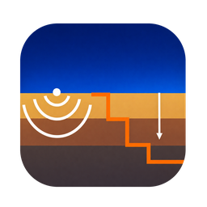
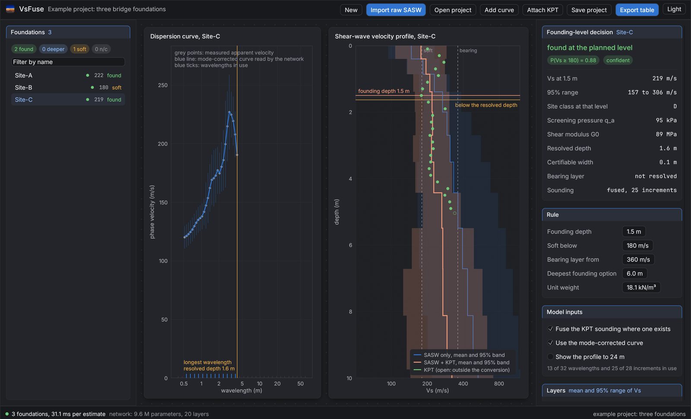
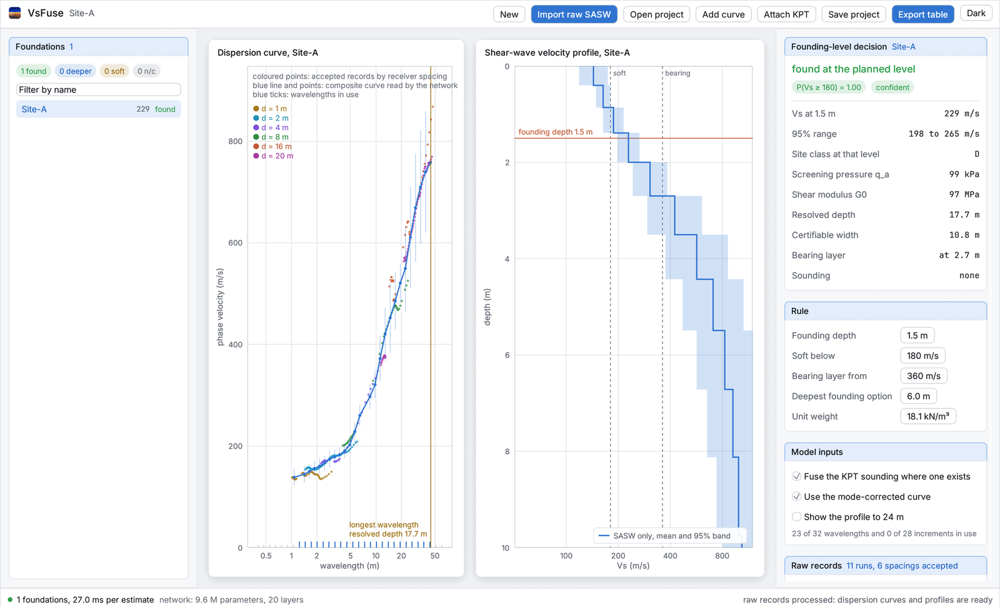
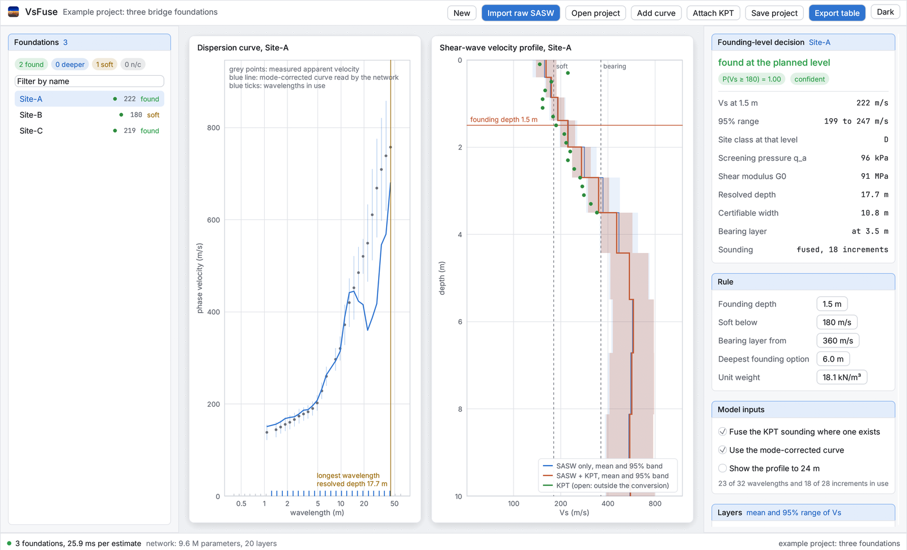

<p align="center"></p>

# VsFuse

**From raw SASW records to a soil profile and a founding-level decision, in one desktop program.**

VsFuse reads the spectra exported by a two-receiver SASW test (spectral analysis of surface waves),
builds the dispersion curve, and returns the shear-wave velocity profile of the ground with its
uncertainty. Where a Kunzelstab (KPT, light dynamic probe) sounding exists at the same foundation,
the program fuses the two tests. It then states whether a spread footing can be founded at the
planned level, and with what probability.

The profile comes from a neural estimator trained only on simulated physics, so no borehole or
measured velocity profile is needed to use it. The network runs in pure Rust and is built into the
binary: there is no Python, no GPU and no internet connection at run time.



## What the program does

| Step | What happens |
|---|---|
| 1. Read | Every valid run of every record of a site is read (transfer function and coherence). |
| 2. Unwrap | The phase of each record is unwrapped across spacings: a shorter receiver spacing fixes the whole-cycle count of the next longer one. |
| 3. Accept | Data are kept only where the forward and reverse shots, or two different spacings, agree. |
| 4. Curve | The accepted points are merged into one composite dispersion curve with its uncertainty, and the depth that the records resolve is stated. |
| 5. Estimate | The neural fusion estimator returns the mean and standard deviation of Vs in 20 layers, from the curve alone and with the KPT sounding where one exists. |
| 6. Decide | The founding-level rule classifies the foundation and gives the probability that the ground at the founding depth is firm. |

### Starting from raw records

`Import raw SASW` takes the folder of one site, or a folder that holds many site folders. The
coloured points are the accepted records of each receiver spacing, the blue line is the composite
curve that the network reads, and the card on the right lists what was accepted and rejected.



### Fusing a sounding

With a KPT sounding attached, the window shows both posteriors: blue from the surface waves alone,
orange with the sounding. The sounding narrows the band over its own depth and corrects the shape of
the profile, and the decision card updates.



## The window

* **Foundations** (left): every site of the project with Vs at the founding depth and its verdict
  (found, deeper, soft, n/c). A dot marks sites with a sounding. The chips count the verdicts.
* **Dispersion curve** (centre left): measured curve with its uncertainty, the 32 wavelengths the
  network reads (bright ticks where measured), and the longest wavelength with the resolved depth.
* **Shear-wave velocity profile** (centre right): posterior mean and 95 % band, KPT points, the
  founding depth, the soft and bearing limits, and the zone below the resolved depth.
* **Founding-level decision** (right): verdict, probability, Vs and its 95 % range, site class,
  screening pressure, shear modulus, resolved depth, certifiable footing width and bearing layer.
* **Rule**: founding depth, soft and bearing velocities, deepest founding option and unit weight
  can all be changed, and every verdict updates at once.
* **Raw records**: coherence flag and the processing report of the site.
* **Layers**: mean and 95 % range of Vs in each layer, which can be saved as CSV.

Top bar: `New`, `Import raw SASW`, `Open project`, `Add curve`, `Attach KPT`, `Save project`,
`Export table` (founding-level table of every foundation as CSV) and the light/dark switch.

## Download

Ready-made programs for version 0.1.0 are on the [releases page](https://github.com/Sompote/VSFuse/releases):

| System | File | Notes |
|---|---|---|
| macOS 10.13 or newer, Intel and Apple silicon | `VsFuse-0.1.0-macos-universal.zip` | Unzip and open `VsFuse.app`. The app is not notarised: the first time, right-click it and choose Open, or allow it under System Settings, Privacy and Security. |
| Windows 10 or 11, 64-bit | `VsFuse-0.1.0-windows-x64.zip` | Unzip and run `VsFuse.exe`. SmartScreen may ask for confirmation because the program is not signed. |

Both packages include the three example foundations. `dist/package.sh` rebuilds them.

## Install and run

Rust 1.85 or newer is needed. The first build takes a few minutes.

```text
git clone https://github.com/Sompote/VSFuse
cd VSFuse
cargo build --release

target/release/vsfuse                                            the window, with three example foundations
target/release/vsfuse project.json                               the window, with your project
target/release/vsfuse process RAW_DIR project.json [table.csv]   raw records to a project and a table, no window
target/release/vsfuse batch project.json table.csv               founding-level table of a project, no window
target/release/vsfuse --mcp [--project project.json]             the tools as an MCP server, for an agent
cargo test --release                                             checks the forward pass against PyTorch
```

## Use by an AI agent (MCP)

`vsfuse --mcp` runs the program as a Model Context Protocol server on stdio, with no window. An
agent can then process raw records, attach soundings, read profiles and decisions, change the rule
and export tables. One project is held in memory for the session; `--project file.json` opens one
at the start.

Register it with Claude Code:

```text
claude mcp add --scope user vsfuse -- /full/path/to/target/release/vsfuse --mcp
```

or in any MCP client configuration:

```json
{"mcpServers": {"vsfuse": {"command": "/full/path/to/target/release/vsfuse", "args": ["--mcp"]}}}
```

| Tool | What it does |
|---|---|
| `new_project`, `open_project`, `save_project` | Start, open or save the project in memory |
| `process_raw` | Raw SASW records of one site folder, or of a folder of sites, to dispersion curves |
| `add_curve` | Add a foundation from a dispersion curve given as arrays |
| `attach_kpt` | Attach a KPT sounding (depths and N20) to a foundation |
| `remove_site` | Remove a foundation |
| `list_sites` | Every foundation with Vs at the founding depth, probability and verdict |
| `get_site` | Decision, Vs per layer with 95 % range (SASW alone and fused), curve, record report |
| `get_rule`, `set_rule` | Read or change the founding-level rule |
| `summary` | Verdict counts and the foundations whose decision is uncertain |
| `export_table`, `export_profile` | Write the founding-level table or one profile as CSV |
| `screenshot` | Render the window for one foundation to a PNG (needs a display) |

A typical request to the agent: *"Process the records in `/data/bridge12`, attach this sounding to
P3, and tell me which piers cannot be founded at 2 m."* The agent calls `process_raw`, `attach_kpt`,
`set_rule` and `summary`, and reads the profile of any pier with `get_site`.

## Inputs

### Raw SASW records

One folder per site, with one folder per record. The record name holds the receiver spacing and the
shot direction, and each run holds the ASCII export of the signal analyser:

```text
Site-A/
  H1mF_HM.trf/Run00001/ASCII/Hxysv00000.txt     transfer function: frequency, real, imaginary
  H1mF_HM.trf/Run00001/ASCII/Cxysv00000.txt     coherence: frequency, coherence
  H1mR_HM.trf/Run00001/ASCII/...
  H16mF_DW.trf/Run00001/ASCII/...
```

`H4mF` is a 4 m spacing with a forward shot and `H4mR` the reverse shot. Any text may follow
(`_HM` for hammer, `_DW` for drop weight). The header of each file ends at the line that starts with
`Hz`. A record may hold several runs, and all valid ones are used.

### Dispersion curve

`Add curve` reads a text file with one row per point: wavelength (m), phase velocity (m/s) and,
optionally, the relative uncertainty. Commas, semicolons or spaces separate the columns, and header
lines are skipped.

### KPT sounding

`Attach KPT` reads a text file with one row per 200 mm increment: mid-depth (m) and N20. It is
attached to the selected foundation.

### Project file

JSON, written by `Save project` and by `vsfuse process`:

```json
{"name": "My bridge",
 "sites": {"P1": {"wavelength": [1.0, 2.0, 4.0], "velocity": [150, 170, 210],
                  "sigma_rel": [0.1, 0.1, 0.12], "z_res": 6.7,
                  "kpt": [{"z": 0.1, "n20": 12}, {"z": 0.3, "n20": 15}]}}}
```

`sigma_rel`, `mode_ratio`, `z_res` and `kpt` are optional. `sample/example_project.json` holds three
anonymised foundations.

## Method

### From records to a dispersion curve

The phase of a two-receiver transfer function is known only to within whole cycles, and one wrong
cycle changes the velocity by a large factor. A single record cannot fix its own count, but the
other spacings of the site can, because the phase at a given frequency is proportional to the
spacing. Spacings are processed from short to long. Each record is cut into coherent segments
(coherence at least 0.95 up to 4 m spacing and 0.90 beyond), and each segment takes the cycle count
closest to the prediction from the spacings already resolved. The shortest spacing is anchored by
the condition that its first coherent phase lies between −0.25 and 0.75 cycle.

Points are kept for wavelengths between half and three times the spacing. A record needs at least
ten points and a monotonic phase. Forward and reverse phases of a spacing are averaged, spacings
whose curves agree within 25 % form a group, and only the largest group is accepted. The composite
curve is the median in logarithmic wavelength bins, and its uncertainty is the scatter in each bin,
raised for data that only one shot direction supports. The resolved depth is the longest accepted
wavelength divided by 2.5.

### The neural fusion estimator

The estimator is a surrogate of a Bayesian inversion. It was trained on 1.2 million simulated
ground profiles: each profile was passed through the Rayleigh-wave forward model, and noise,
wavelength coverage and a synthetic sounding were added with the statistics of real field data.
The network never saw a field label.

* Input: 152 numbers. Phase velocity, a mask and the uncertainty at 32 wavelengths from 0.4 to
  60 m, and the KPT-derived velocity and a mask at 28 increments from 0.1 to 5.5 m.
* Body: a residual multilayer perceptron, width 768, eight blocks, 9.6 million parameters.
* Output: mean and standard deviation of ln Vs in 19 layers to 24 m and a half-space.

The sounding is modelled as a point test: its converted velocity is the layer velocity plus an
offset shared by the whole sounding plus increment noise. It therefore informs the shape of the
profile strongly and its level only weakly.

KPT blow counts are converted with N = 0.539 (N20 + 0.954) and Vs = 96.9 N^0.314, for full
increments with 6 ≤ N20 ≤ 100 (147 to 340 m/s). Increments outside that range are shown as open
circles and are not used.

### Founding-level rule

At the founding depth D_f (default 1.5 m):

| Verdict | Condition |
|---|---|
| not certifiable | the resolved depth does not reach D_f |
| found at the planned level | Vs ≥ 180 m/s at D_f |
| found deeper | softer at D_f, and a layer with Vs ≥ 360 m/s lies within 6 m and within the resolved depth |
| soft within the resolved depth | otherwise |

The program also reports the probability that Vs at D_f reaches 180 m/s, from the stated standard
deviation. A foundation is called confident when that probability is at least 0.84 or at most 0.16.
Other outputs are the screening pressure q_a = 0.024 γ Vs, the shear modulus G0 = ρ Vs², and the
widest footing whose settlement zone lies inside the measured profile, B_max = (z_res − D_f) / 1.5.

## Validation

* **Network in Rust.** The Rust forward pass reproduces the PyTorch outputs at the example
  foundations to within 0.02 in ln Vs (`cargo test --release`).
* **Front end in Rust.** Against the Python reference pipeline (GateSASW) on a case study of 164
  bridge foundations, the composite curves are identical at 144 sites and within 1 % at 153. The
  other 11 differ because the reference breaks exact ties by floating-point and sort order. That
  data set is not included here.
* **Estimator against field data.** On the same case study, the estimator working from SASW alone
  agrees with KPT-derived velocity with a log-residual of 0.37 over 889 paired depths, and 88 % of
  them lie inside the 95 % band of the conversion. A conventional physics-based inversion gives 0.35,
  so the estimator matches the conventional method and does not exceed it. Its value is the stated
  uncertainty, the fusion with the sounding and the speed.

## Limits

* The velocity is a screening value. The bearing pressure and the verdict do not replace a
  foundation design, and the rule thresholds should be set by the engineer.
* A curve made from raw records is not corrected for the apparent velocity of the two-receiver
  array, because that correction needs an inversion. In the case study this raised the log-residual
  from 0.37 to 0.41.
* The network was trained for profiles that stiffen with depth, with optional stiff strata, soft
  layers and a stiff crust, and for Vs between 55 and 1,150 m/s. Strong velocity reversals at depth
  and rock at the surface lie at the edge of that range.
* The input is the exported transfer function and coherence. Raw time-domain geophone signals are
  not read.
* Below the resolved depth the profile is an extrapolation and is shaded in the plot.

## Repository

```text
src/frontend.rs   raw records to composite dispersion curve
src/num.rs        numerical routines that follow numpy and scipy conventions
src/model.rs      forward pass of the estimator
src/data.rs       project file, text import, KPT conversion
src/decision.rs   founding-level rule
src/engine.rs     batch runs and CSV tables
src/mcp.rs        MCP server for agents
src/app.rs        the window
src/theme.rs, src/chrome.rs   colours, fonts and widgets
assets/model.vsf  trained network (38 MB)
tools/export_weights.py   converts a trained PyTorch model to assets/model.vsf
sample/           three anonymised example foundations
```

For screenshots without clicking: `VSFUSE_SHOT=out.png [VSFUSE_SITE=name] [VSFUSE_THEME=light]
[VSFUSE_RAW=site_folder] vsfuse` saves one frame and quits.

## Licence

MIT, see `LICENSE`. The fonts (Inter, JetBrains Mono, Noto Sans Thai) are under the SIL Open Font
License, see `assets/fonts`. The interface theme follows TellusHive.
